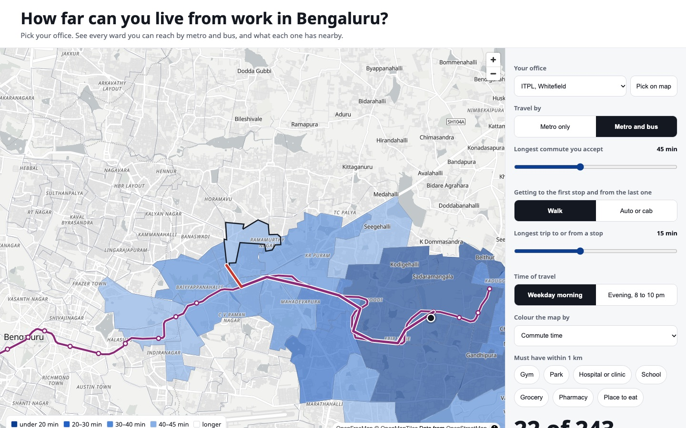
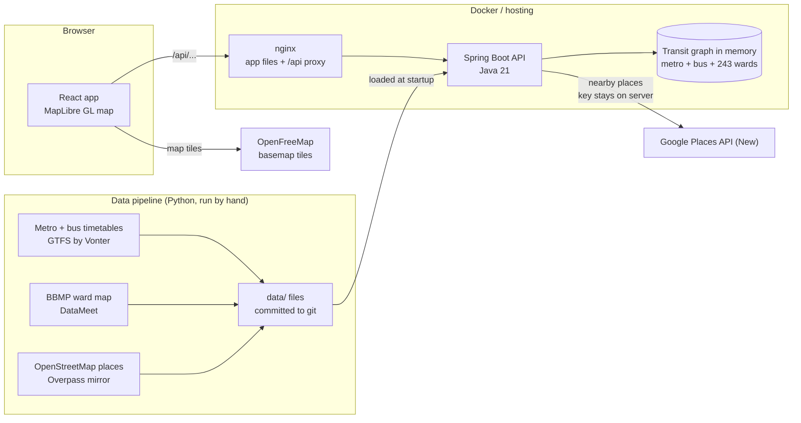

# Bengaluru Commute Map

**How far can you live from work in Bengaluru?**

Pick your office (from presets or anywhere on the map), the longest commute you'll accept, how you get to stops (walk, or
auto/cab), and the time of day. The map shades every Bengaluru ward you can reach by **Namma Metro + BMTC bus** in that
time. It lists the wards quickest first and draws the trip for any ward: walk → bus/metro → change → walk. Each ward
also shows what's nearby (gyms, parks, hospitals and clinics, schools, groceries, pharmacies, places to eat), with
scores and "must have within 1 km" filters.



## What's inside

| Part | Stack | What it does |
|---|---|---|
| [`backend/`](backend/README.md) | Java 21, Spring Boot 3.5, Maven | Loads the transit network into memory at startup (~0.1 s) and runs the route search: a 90-minute search takes ~10 ms. Also proxies Google Places, so the API key stays on the server. |
| [`frontend/`](frontend/README.md) | React 19, TypeScript, Vite, MapLibre GL JS | The map and controls, on free OpenStreetMap-based tiles from OpenFreeMap. |
| [`pipeline/`](pipeline/README.md) | Python | Downloads the pinned timetables and ward map, counts places from OpenStreetMap, and writes the small files in `data/`. |
| [`data/`](data) | JSON | The prepared data, about 1 MB, committed so the app runs without the 100 MB download. |
| [`tools/golden/`](tools/golden/README.md) | Node | Runs the original prototype's own search to produce the answers the Java tests must match. |
| [`reference/`](reference) | | The original single-file prototype and its notes. |

## Architecture



## How the routing works, in plain words

1. **The network.** Every bus stop is a point. So is every metro station, once per line, so a station on two lines is
   two points joined by a "change lines" link.
   - Bus stops within 250 m of each other are joined by a walk.
   - Bus stops within 400 m of a station are joined to it.
   - Rides come from the timetables (GTFS, the standard file format for public transport timetables).
2. **Starting out.** From your office you walk (4.8 km/h, along a path 30% longer than a straight line) or take an auto
   or cab (18 km/h on a road 40% longer, plus 5 minutes to get one) to any stop within your "longest trip to a stop".
3. **Searching.** The search always continues from the stop it can reach soonest, so each stop is reached at its best
   time. This is Dijkstra's shortest-path algorithm, and it stops at your time limit.
   - **Metro:** waiting is half the gap between trains at that station. Entering adds 2 minutes, leaving 1, and changing
     lines 3 plus the wait.
   - **Bus:**
     - Timetable times assume about 22 km/h all day, but peak traffic is closer to 10–12 km/h. So rides take 1.8× the
       timetable time in the morning and 1.4× in the evening.
     - When several routes go to the same next stop, their buses count together for the wait, as long as they are
       nearly as fast (at most 1.25× the fastest + 2 min).
     - The wait is half the combined gap, between 1 and 15 minutes.
4. **Reaching a ward.** A ward counts if you can get to its nearest edge, plus a 300 m walk into it. The trip must include
   at least one bus or metro ride, unless the ward's centre is close enough to go straight there.

The Java search is a careful port of the [original prototype](reference/bengaluru-commute-map-prototype). A test checks
both give exactly the same minutes, lines and step wording for all 243 wards, over 12 different searches. JavaScript's
`Math.hypot` is copied bit for bit so that holds. The checks recorded in the prototype's notes pass too:

| Check | Result |
|---|---|
| ITPL, 45 min, walking: wards by metro only / with buses | 17 / 22 |
| MG Road, 45 min, walking: metro only / with buses | 50 / 86 |
| Pattandur Agrahara → Indiranagar, Purple Line | 27 min |
| Manyatha Tech Park → Kalyananagara by bus, morning | about 13 min |

One improvement on the prototype is switched on, the **ride fix**:

- The prototype keeps one best time per stop. So when a stop is reached fastest on foot, a slightly slower way there that
  includes a ride is lost, and wards that need it can be missed.
- The fix keeps both times. It never makes a ward slower, leaves the counts above unchanged, and makes some wards
  1–10 minutes quicker, mostly when going by auto.
- `RIDE_FIX=false` gives the prototype's exact results. The prototype comparison tests run that way.

Three smaller differences from the prototype, all on purpose:

- **"or N other routes"** after a bus counts distinct route *numbers* (500-D, 335-E…), not route variants (one number
  can have several sets of stops). The same goes for "N routes stop there". Hover over the bus chip to see the numbers.
- **Big parks count.** Places drawn on OpenStreetMap as several pieces ("relations"), such as many lake parks, are now
  counted. That adds 58 parks inside wards, plus 11 schools and 7 hospitals or clinics.
- **"Nearest" is measured from inside the ward.** The prototype measured from the ward's centroid (geometric centre),
  which falls outside 9 oddly shaped wards. Those now use a point inside the ward; every other ward is unchanged.

`python pipeline/build_places.py --like-prototype` rebuilds the place data the prototype's way.

## Run it

You need [Docker Desktop](https://www.docker.com/products/docker-desktop/) for the one-command way; for development,
Java 21+ and Node 22+.

**Ports**

| What | Address | Change it with |
|---|---|---|
| The app in Docker (frontend, with `/api` forwarded to the backend) | <http://localhost:8090> | `APP_PORT` |
| The backend inside Docker | port 8080, private to Docker (not opened on your machine) | — |
| The backend in development | <http://localhost:8081> | `PORT` |
| The frontend in development | <http://localhost:5180> | `--port`, plus `BACKEND_URL` if the backend moved |

**With Docker (one command).** Docker Desktop must be running first:

```bash
docker desktop start                        # or open the Docker app; wait until this works:
docker info --format '{{.ServerVersion}}'   # prints a version when the engine is ready
docker compose up --build                   # then open http://localhost:8090
```

- **Port 8090 taken?** Run `APP_PORT=8095 docker compose up --build` and open <http://localhost:8095>, or put
  `APP_PORT=8095` in `.env`.
- **Stop it** with `docker compose down`.
- **Errors like `500 Internal Server Error ... docker.sock/_ping`, or `docker ps` hanging?** The Docker engine isn't ready
  or is stuck. Check with `docker desktop status`, then run `docker desktop restart`. If that reports processes still
  running, run `docker desktop stop --force` and then `docker desktop start`.

**For development**, in two terminals:

```bash
cd backend && ./mvnw spring-boot:run             # API on http://localhost:8081
cd frontend && npm install && npm run dev        # app on http://localhost:5180 (forwards /api to the backend)
```

Check the API with `curl "http://localhost:8081/api/reach?lat=12.9855&lon=77.7368"`. It should report `"reachable": 22`
(ITPL, 45 minutes, walking, metro and bus).

**Other ports for development:** run `PORT=8085 ./mvnw spring-boot:run`, then
`BACKEND_URL=http://localhost:8085 npm run dev -- --port 5190`. If 5180 is busy, Vite picks the next free port by itself
and prints it.

**Nearby places from Google** are optional:

1. Copy `.env.example` to `.env`.
2. Set `GOOGLE_PLACES_API_KEY`. Use a key restricted to Places API (New), with a daily quota set in Google Cloud Console.
3. Restart.

Without a key, that section simply doesn't appear. Details and costs are in [backend/README.md](backend/README.md#google-nearby-places).

**Tests:**

```bash
cd backend && ./mvnw verify          # 57 tests: prototype parity, known cases, rules, speed, API, Google proxy
cd frontend && npm test && npm run lint && npm run typecheck
node tools/golden/golden.mjs         # regenerate the prototype's answers (CI checks they're unchanged)
```

**Refreshing the data:** see [pipeline/README.md](pipeline/README.md).

GitHub Actions ([`.github/workflows/ci.yml`](.github/workflows/ci.yml)) runs all of this on every push and pull request:

- builds and tests the backend and the frontend,
- checks the golden answers are up to date,
- compiles the pipeline,
- builds both Docker images.

## Data sources and licences

| Data | Source | Licence | Credit |
|---|---|---|---|
| Namma Metro timetable | [Vonter/bmrcl-gtfs](https://github.com/Vonter/bmrcl-gtfs), unofficial, 17 Aug 2026 | ODbL 1.0 | Vonter |
| BMTC bus timetable | [Vonter/bmtc-gtfs](https://github.com/Vonter/bmtc-gtfs), unofficial, built from the Namma BMTC app, 9 Nov 2026 | ODbL 1.0 | Vonter |
| 243 BBMP ward boundaries | [DataMeet Municipal Spatial Data](https://github.com/datameet/Municipal_Spatial_Data) | CC BY 4.0 | DataMeet India community |
| Gyms, parks, clinics, schools, groceries, pharmacies, places to eat | [OpenStreetMap](https://www.openstreetmap.org/copyright) via the Overpass API | ODbL 1.0 | © OpenStreetMap contributors |
| Basemap tiles | [OpenFreeMap](https://openfreemap.org) | OpenStreetMap data, ODbL | OpenFreeMap © OpenMapTiles, data © OpenStreetMap (shown on the map) |
| Nearby places (optional) | [Google Places API (New)](https://developers.google.com/maps/documentation/places/web-service/nearby-search) | Google Maps Platform Terms | "Google Maps" attribution shown with the list |

The files in `data/` are derived from ODbL and CC BY sources and keep those licences. The code is MIT ([LICENSE](LICENSE)).

## Known limits

- **Unofficial timetables.** Both feeds are community-built, not published by BMRCL or BMTC. The bus feed only has routes
  with live tracking. Real services vary day to day, and there are no live arrivals here.
- **Bus traffic is a flat estimate.** The 1.8× morning and 1.4× evening factors come from news reports of average peak
  speeds, not measurements on each road. Some corridors will be faster, others slower.
- **Waits are averages.** Half the gap between trains or buses; your actual wait depends on when you arrive.
- **One direction.** Times are measured from the office outward. The trip to work is usually similar, not identical.
- **Weekday means Tuesday.** The bus timetable is the Tuesday service, which matches the prototype exactly.
- **Ward edges.** A ward counts as reached at its nearest edge plus 300 m, so the far side of a large ward takes longer.
  Walking distances are straight lines × 1.3.
- **Missing places.** OpenStreetMap is built by volunteers and misses many places, especially gyms and small shops: 139
  of 243 wards have no gym mapped. Scores compare wards with each other, so treat counts as a guide.
- **Old ward map.** These are the 243 BBMP wards. Bengaluru has since moved to the Greater Bengaluru Authority with new
  wards.
- **Hosting.** The OpenFreeMap tile service is free with no uptime promise. The Google proxy's per-visitor limit goes by
  IP address, which a determined user could fake, but the site-wide daily cap still holds.

## Deploying

See [docs/DEPLOY.md](docs/DEPLOY.md) for the recommended free setup and the steps. In short: the frontend on Cloudflare
Pages, the backend on Google Cloud Run (free monthly allowance), with Render's free plan as a no-card alternative.
